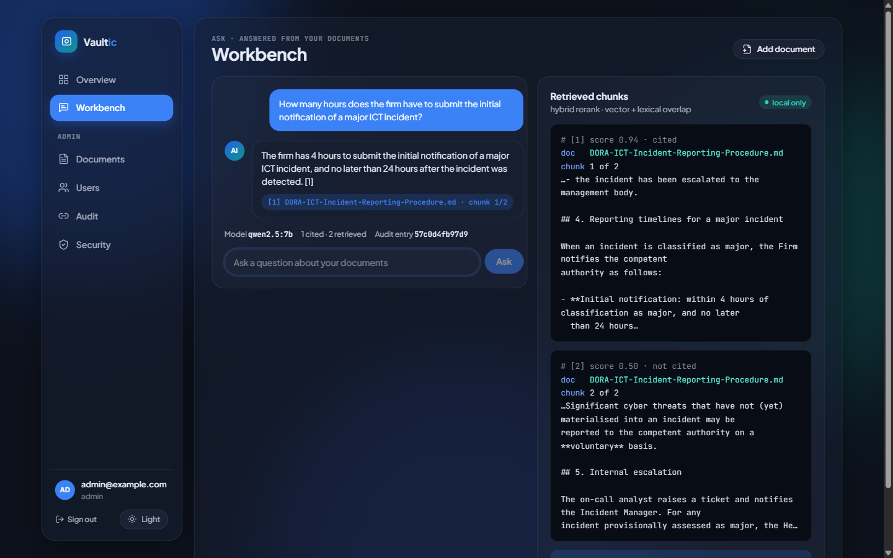
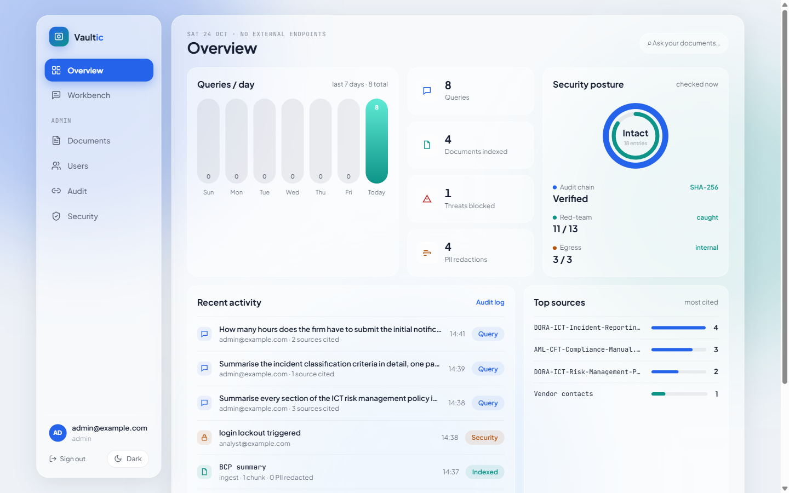
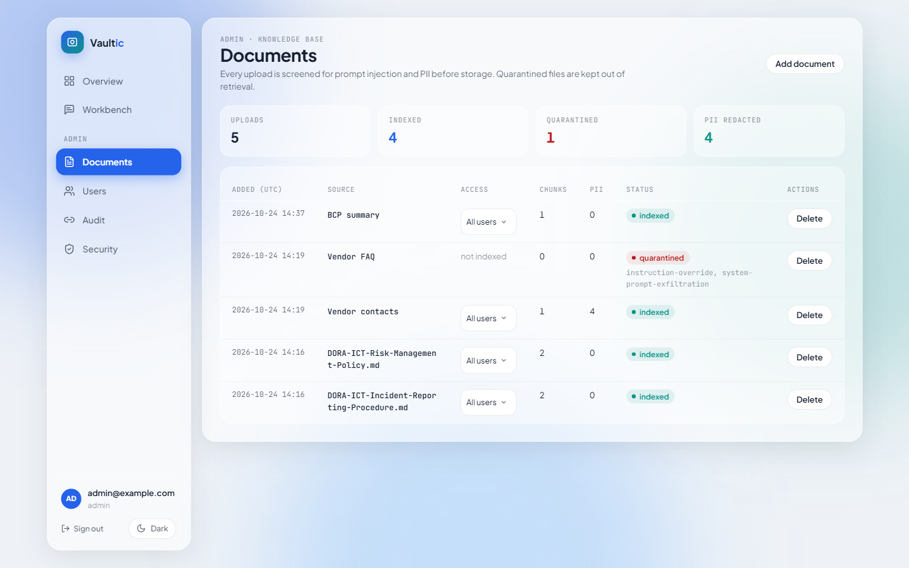
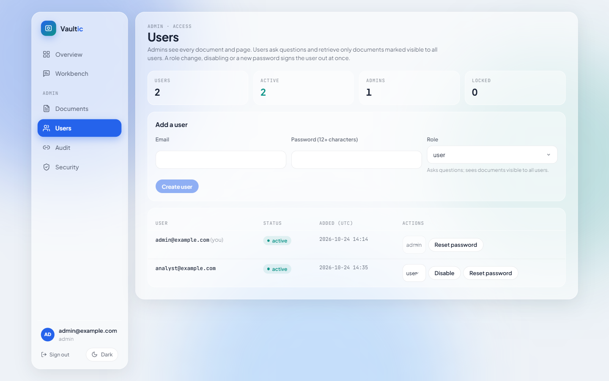
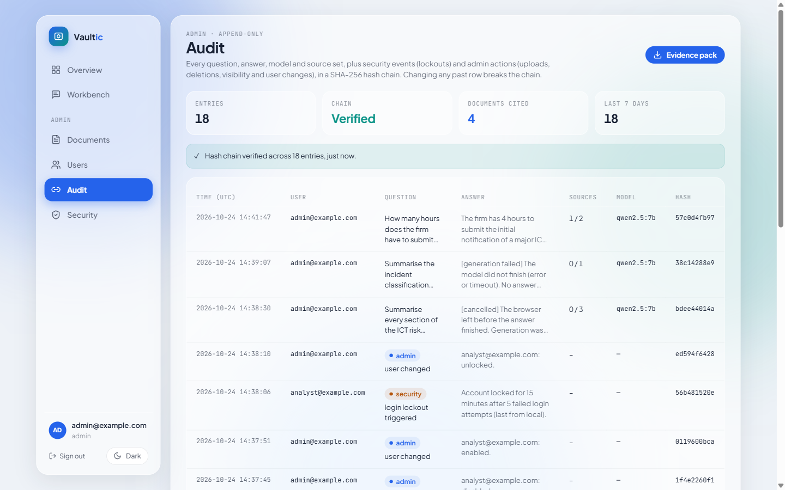

# Vaultic

A private AI assistant over your own documents that runs entirely on your own infrastructure. You upload documents, ask questions in plain language, and get answers generated by a local open-weight model from those documents only, with the source passages cited and every exchange written to a tamper-evident audit log.

Vaultic is aimed at organisations that cannot send internal documents to a cloud AI service: finance, insurance, healthcare, legal, public sector. The answer path has no external API call; models, retrieval and storage all run in the bundled containers.

**Status:** early pilot (v0). The core flow works; connectors, multi-tenancy and per-task models are not implemented.



## Architecture

One `docker compose up` starts five services on a private bridge network (plus a one-shot model download). Only the assistant publishes a port, and only on `127.0.0.1`.

```
documents -> ingest -> extract -> injection scan -> PII redaction -> chunk + embed -> Qdrant
                                                                                    |
user -> assistant (Next.js) --> bridge /rag/search --> Ollama embeddings --> Qdrant (cited context)
            |            \--> Ollama (local generation)
            \--> Postgres (users/RBAC, document metadata, hash-chained audit log)
```

| Service | Image / build | Role | Host port |
| --- | --- | --- | --- |
| `vaultic-assistant` | `assistant/` (Next.js 16) | UI, auth, ingest, chat, audit/RBAC/evidence | `127.0.0.1:${VAULTIC_PORT}` (default 3029) |
| `vaultic-bridge` | `bridge/` (Node) | RAG gateway: `/rag/*` (Ollama embeddings -> Qdrant), `/health`, `/metrics` | internal |
| `vaultic-knowledge` | `qdrant/qdrant` | vector store for your documents | internal |
| `vaultic-ollama` | `ollama/ollama` | local generation and embedding models (CPU by default) | internal |
| `vaultic-models` | `ollama/ollama` | one-shot: pulls `GEN_MODEL` and `EMBED_MODEL` into `vaultic-ollama` | none |
| `vaultic-postgres` | `postgres:16-alpine` | users, documents, audit log, login throttling | internal |

There are no fixed container or volume names, so `docker compose -p <name>` keeps several copies apart.

The bridge image installs no cloud-LLM CLI and mounts no credentials, so there is no external-API code path in the deployed stack.

## Features

- **Cited answers** - the model answers only from retrieved passages. Passages scoring under half of the best one are dropped before generation; the answer shows the passages it actually cites, and the audit entry records each retrieved passage as cited or not. An answer the documents cannot support says so and cites nothing.
- **Local hybrid reranking** - vector similarity blended with lexical overlap, deterministic, no extra model.
- **Tamper-evident audit log** - every question, answer, model and source set is appended to a SHA-256 hash chain in Postgres, together with login lockouts and admin actions (uploads, quarantines, deletions, visibility and user changes); the Audit page verifies the chain. A generation that fails or that the user abandons is recorded as such, never as a partial answer.
- **Users and roles** - `admin` and `user` roles, managed on the Users page: create accounts, change roles, disable, unlock after a lockout, set a new password. Every change signs the user out at once. Documents carry a visibility flag; non-admin users only retrieve documents marked visible to all. Ingest, documents, users, audit and security pages are admin-only.
- **Document management** - delete a document (its chunks leave the vector store) or change who can retrieve it after upload. The same content is not indexed twice: a re-upload names the existing document.
- **Ingest guardrails** - PDF (via `unpdf`), TXT, Markdown, CSV and JSON. PII (emails, phone numbers, IBANs, Luhn-valid card numbers, US SSNs) is redacted before anything is stored; documents matching prompt-injection / RAG-poisoning patterns are quarantined.
- **Red-team self-test** - runs a fixed set of injection, PII and benign cases against the guard and redactor and reports what is caught, including known misses.
- **Egress containment** - the Security page lists every configured endpoint classified as internal/external and generates default-deny host firewall rules (iptables / nftables) that enforce it.
- **Supply-chain evidence** - a CycloneDX SBOM is generated at image build time and served (admin-only) alongside an evidence summary.
- **Login protection** - Postgres-backed per-IP rate limit (fail-open) and per-account lockout after 5 failures (fail-closed).
- **Overview dashboard** - queries per day (last 7 days), documents indexed, threats blocked, PII redactions, audit-chain status, red-team and egress results, most-cited sources and recent activity, all computed from real rows. Non-admin users see only their own questions and documents visible to all.
- **Light and dark theme** - follows the OS setting until you pick one in the sidebar; fonts are self-hosted, so the UI makes no external requests.

## Screenshots

| | |
| --- | --- |
|  |  |
|  |  |

## Tech stack

Next.js 16, React 19, TypeScript, Prisma 7 (`@prisma/adapter-pg`), PostgreSQL 16, Qdrant, Ollama, `jose` (HS256 JWT sessions), `bcryptjs`, `zod`, `unpdf`, CycloneDX.

## Quick start

Requirements: Docker with Compose v2.20 or newer (Docker Desktop on Windows/macOS, Docker Engine + compose plugin on Linux), about 7 GB of free disk for the models, and about 8 GB of RAM available to Docker for CPU inference. The commands are the same in PowerShell and bash.

```bash
git clone <this repo> vaultic
cd vaultic
cp .env.example .env          # PowerShell: Copy-Item .env.example .env
```

Edit `.env`: set `POSTGRES_PASSWORD` (letters and digits), `JWT_SECRET` (32+ random characters; `.env.example` shows how to generate one on each OS) and `VAULTIC_ADMIN_EMAIL` / `VAULTIC_ADMIN_PASSWORD`. Change `VAULTIC_PORT` if 3029 is taken.

```bash
docker compose up -d --build
docker compose logs -f vaultic-models   # first run: downloads the models, then exits
```

Open http://127.0.0.1:3029 and log in with `VAULTIC_ADMIN_EMAIL` / `VAULTIC_ADMIN_PASSWORD` (the admin user is created on the first login while the user table is empty). Further accounts are created on the **Users** page; Vaultic sends no email, so pass the password on yourself. In the **Workbench**, click **Add document**, upload one of the files in `demo-docs/` and ask a question about it, for example "How many hours does the firm have to submit the initial notification of a major ICT incident?".

Stop with `docker compose down` (add `-v` to delete documents, audit log and models).

### Models

| Setting | Default | Size | Used for |
| --- | --- | --- | --- |
| `GEN_MODEL` | `qwen2.5:7b` | ~4.7 GB | answer generation |
| `EMBED_MODEL` | `nomic-embed-text` | ~0.3 GB | document and query embeddings (768 dimensions, set `EMBED_DIM` to match another model) |

On CPU, a 7B model answers in roughly 10 to 60 seconds depending on the machine and `OLLAMA_CPUS`. A smaller `GEN_MODEL` (for example `qwen2.5:3b`, ~1.9 GB) is faster; a larger one gives better answers. After changing a model, run `docker compose up -d` again; `vaultic-models` pulls whatever is missing. Changing `EMBED_MODEL` requires re-ingesting documents.

### NVIDIA GPU (optional)

The default is CPU so the stack runs on any machine. With an NVIDIA GPU and the NVIDIA Container Toolkit (Linux) or Docker Desktop's WSL2 GPU support (Windows), add the GPU override:

```bash
docker compose -f docker-compose.yml -f docker-compose.gpu.yml up -d --build
```

### Use an existing Ollama instead of the bundled one

If Ollama already runs on the host or elsewhere, skip the bundled container: in `.env`, delete the `COMPOSE_PROFILES=ollama` line and set

```bash
OLLAMA_URL=http://host.docker.internal:11434   # Ollama on the Docker host
```

Pull both models there first (`ollama pull qwen2.5:7b`, `ollama pull nomic-embed-text`) or set `GEN_MODEL` / `EMBED_MODEL` to models it already has. On Linux, Ollama must listen on more than `127.0.0.1` for containers to reach it (`OLLAMA_HOST=0.0.0.0` in its service environment). Note that the answer path then leaves the compose network for that Ollama instance; the Security page lists it as an endpoint.

## Configuration

All settings come from `.env` (see `.env.example`):

| Variable | Required | Purpose |
| --- | --- | --- |
| `POSTGRES_USER`, `POSTGRES_PASSWORD`, `POSTGRES_DB` | yes | database credentials |
| `JWT_SECRET` | yes | session signing key, min. 32 chars; obvious placeholders are rejected |
| `VAULTIC_ADMIN_EMAIL`, `VAULTIC_ADMIN_PASSWORD` | yes | first admin account |
| `VAULTIC_PORT` | no | host port on 127.0.0.1 (default `3029`) |
| `COMPOSE_PROFILES` | no | `ollama` (default in `.env.example`) starts the bundled Ollama and model download |
| `OLLAMA_URL` | no | Ollama used by the assistant and bridge (default: the bundled `http://vaultic-ollama:11434`) |
| `GEN_MODEL` | no | generation model (default `qwen2.5:7b`) |
| `EMBED_MODEL`, `EMBED_DIM` | no | embedding model and its dimension (default `nomic-embed-text`, `768`) |
| `OLLAMA_CPUS` | no | CPU cores for the bundled Ollama (default `6`). Sets the container limit and the thread count sent with every request; set `0` when using an external Ollama |
| `TRUST_PROXY` | no | `true` only behind a trusted reverse proxy |

The assistant also reads `OLLAMA_TIMEOUT_MS` (default 300000) and `OLLAMA_KEEP_ALIVE` (default `5m`: how long the model stays in memory after a question; a 7B model holds about 5 GB, so a longer value trades RAM for skipping the reload).

## Demo data

`demo-docs/` contains three synthetic policy documents (DORA ICT risk management, DORA incident reporting, AML/CFT) for a fictional firm. Upload them in the Workbench to try ingest, cited answers and audit entries. The Overview starts empty and fills from real use; there is no sample dataset.

## Local development

```bash
cd assistant
npm install            # also runs prisma generate
npm run typecheck
npm run lint
npm test               # vitest: PII redaction, chunking, dashboard metrics
npm run build
npm run db:push        # needs DATABASE_URL pointing at a Postgres instance
npm run dev            # http://localhost:3029
```

`BRIDGE_URL` and `OLLAMA_URL` must point at a running bridge and Ollama for chat and ingest to work.

## Tests

`assistant/src/test/` holds a vitest suite (`npm test` in `assistant/`):

- `pii.test.ts`: email, IBAN (spaced and contiguous), Luhn-valid card, US SSN and phone redaction; no false positives on dates and section numbers; the streaming redactor never emits part of a PII value split across model tokens.
- `chunk.test.ts`: the bridge's sentence-window chunker (`bridge/chunk.mjs`): size limit, sentence-boundary cuts, overlap, no lost text, no empty chunks.
- `metrics.test.ts`: the Overview's 7-day buckets, redaction-marker counts, most-cited sources (uncited passages excluded) and the per-role scoping (a non-admin never sees other users' questions, admin events, admin-only documents or quarantined uploads).
- `citations.test.ts`: the relative relevance cut-off and reading `[n]` citations from an answer.
- `users.test.ts`: password rules, and that an admin can neither lock themselves out nor remove the last active admin.

## Limits

- **Pattern-based guards.** Prompt-injection screening and PII redaction match patterns; the red-team self-test lists what they miss (letter-spaced and Base64-encoded attacks). Names, addresses and free-text personal data are not redacted.
- **No OCR.** Scanned PDFs without a text layer are refused.
- **Relevance is relative.** The cut-off keeps passages scoring at least half of the best one in the same search, so a question no document answers still retrieves its closest passages; the model is told to say when they do not contain the answer, and the answer then cites nothing.
- **CPU by default.** A 7B model answers in roughly 10 to 60 seconds on a laptop CPU; the GPU override is optional.
- **No email, no SSO.** Accounts are created by an admin with a password; there is no self-service reset.
- **One organisation, one node.** No multi-tenancy, and login throttling and the audit chain assume a single assistant instance.
- **Early pilot.** Not externally audited; the evidence pack shows how the controls support the listed frameworks, it is not a certification.

## Container hardening

All services run with `cap_drop: [ALL]` (Postgres adds back only what it needs), `no-new-privileges`, memory/CPU/PID limits and log rotation. The assistant, Ollama and Qdrant use read-only root filesystems with tmpfs scratch space; the assistant runs as a non-root user. Images are pinned by digest, and required secrets use `${VAR:?}` so Compose fails fast when one is missing.

## License

MIT - see [LICENSE](LICENSE).
